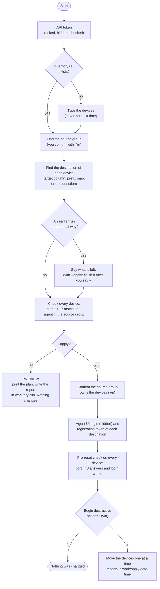
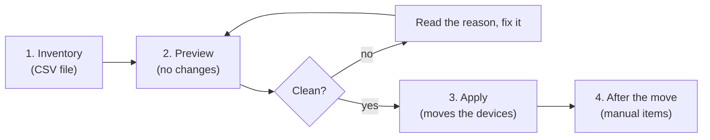
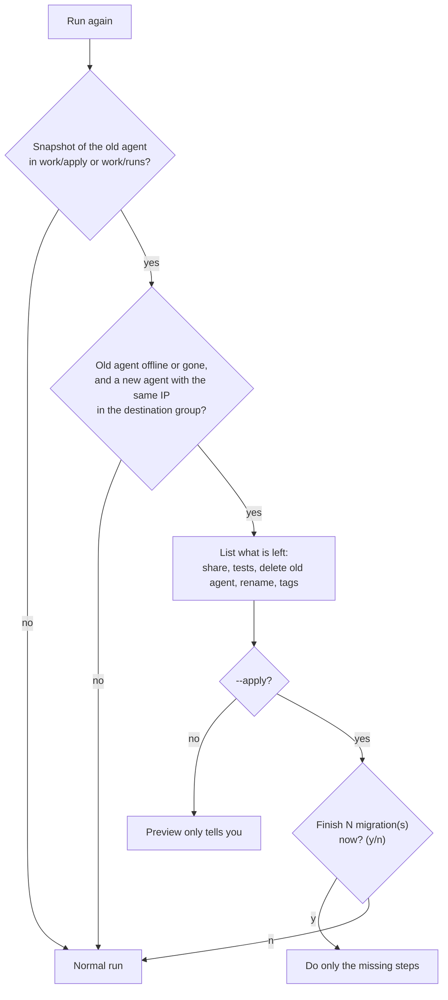
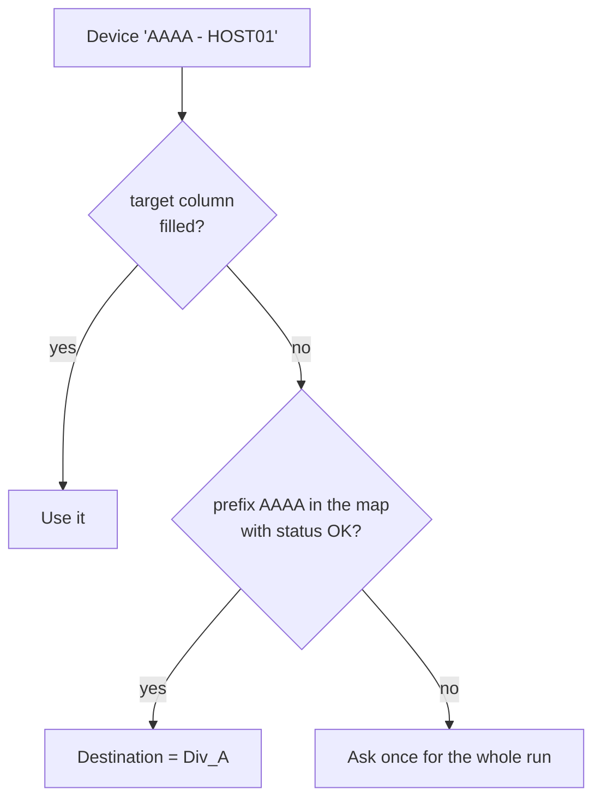

# ThousandEyes Enterprise Agent Migration

Moves ThousandEyes Enterprise Agents (TEVA appliances) from one account group to another.

- **Only the agent moves.** The tests stay in their account group and keep their IDs.
- The new agent is shared with the same account groups that saw the old one, plus the source group.
- The new agent gets the same tests as the old one. The old agent is deleted last.
- The default is a **preview**. Nothing changes until you run it with `--apply`.
- Nothing to configure: no `.env` file, no environment variables. The tool asks for what it needs.

Contents: [Quick start](#quick-start) · [How it works](#how-it-works) · [Setup](#setup-once) ·
[Step by step](#step-by-step) · [What the tool asks](#what-the-tool-asks-you) ·
[If something stops](#if-something-stops) · [Options](#the-options) · [Examples](#examples) ·
[Troubleshooting](#troubleshooting) · [Security](#security-and-what-is-saved-on-disk)

## Quick start

| | macOS / Linux (Terminal) | Windows (Command Prompt) |
|---|---|---|
| Go to the project folder | `cd TE_AGENT_MIGRATE_MINIMAL_REQUIREMENTS` | `cd TE_AGENT_MIGRATE_MINIMAL_REQUIREMENTS` |
| Check Python | `python3 --version` | `python --version` |
| Preview (no changes) | `python3 -m te_agent_migrate` | `python -m te_agent_migrate` |
| Apply (moves the devices) | `python3 -m te_agent_migrate --apply` | `python -m te_agent_migrate --apply` |

1. Run the preview. Answer the questions. Read the plan.
2. If a device is blocked, read the reason (see [Troubleshooting](#troubleshooting)), fix it, run the preview again.
3. When the preview is clean, run with `--apply`.

Start with one device.

## How it works

### What happens to one device

```
BEFORE                                        AFTER
------                                        -----
 Group 100 (source)    Group 300              Group 100 (source)    Group 300
 +-----------------+  +-------------+         +-----------------+  +-------------+
 | tests T1, T2    |  | test T3     |         | tests T1, T2    |  | test T3     |
 | agent  A (old)  |  |  (uses A)   |         |  (use agent B)  |  | (uses B)    |
 +--------+--------+  +------^------+         +-----------------+  +------^------+
          |          shared with |                                  shared with
          +---------------------+              Group 200 (destination)     |
                                               +-----------------+         |
                                               | agent  B (new)  +---------+
                                               | same name, same |  also shared back
                                               | IP, new agent ID|  to group 100
                                               +-----------------+
```

The agent keeps its name and its IP address. It gets a **new agent ID**, because a reset agent that
registers in another group is a new agent for ThousandEyes.

### The steps, one device at a time

```mermaid
flowchart LR
    A["1. Read the old agent A<br/>(groups, tests, tags)"] --> B["2. Save a snapshot file"]
    B --> C["3. Reset the VM<br/>(agent web UI)"]
    C --> D["4. Register it in group 200<br/>with the group token = agent B"]
    D --> E["5. Share B with the same groups<br/>(100, 300 ...)"]
    E --> F["6. Give B the tests that A had"]
    F --> G["7. Point agent-to-agent tests<br/>at B"]
    G --> H["8. Delete the old agent A<br/>(always last)"]
    H --> I["9. Name and tags<br/>restored"]
```



If any step fails the tool stops, prints the state of that device, and leaves the old agent A alone. A is
deleted only after B is online, shared, and has the tests (the tool counts them and retries until they
are all there).

### The run, from your side



The pre-reset check happens **before** the first reset, so a wrong password or a blocked port stops the
run while nothing has been changed.

### Name and IP must match (protects you from moving the wrong device)

```
 inventory line:  MyAgent-01 , 10.1.1.5
                      |            |
                      v            v
 source group 100:  [ agent named MyAgent-01 ]  AND  [ it has IP 10.1.1.5 ]
                      both true, same agent  ->  READY
                      anything else          ->  BLOCKED, nothing touched
```

### Who sees the agent, and who owns it

You never list the groups that must keep seeing the agent. The tool reads them from the old agent and
shares the new agent with the same ones, with the source group, and with the destination group. The
destination group becomes the **owner** of the new agent.

An agent that you see in the source group is either **owned** by that group or only **shared** with it.
The ThousandEyes API does not tell which. This matters because the move deletes the old agent:

```
 CASE 1: the source group OWNS the agent        CASE 2: the source group only SEES it

   Group 100 (source)                             Group 500 (owner)
   +--------------+                               +--------------+
   | agent A      |  <- registered here           | agent A      |  <- registered here
   +------+-------+                               +------+-------+
          | shared with 300                              | shared with 100 (source)
          v                                              v
   Group 300 sees A                               Group 100 sees A, but does not own it

   Move A to group 200:                           Move A to group 200:
   100 gives the agent away.                      group 500 LOSES its agent.
   This is what you want. -> answer y             -> answer n, take the device out
                                                     of the inventory
```

In `--apply` the tool lists the devices and asks "Is the source group the owner of ALL these devices?". A
device that was registered with the source group's own Account Group Token is owned by the source group.
If you are not sure, ask the team that installed the agent before you move it.

### Tests that point at the agent

Most tests only run **from** an agent, so they keep working after the move. An agent-to-agent test
also uses an agent as its **target**. The new agent has a new ID, so the tool changes the target of those
tests to the new agent by itself (step 7 above). The preview tells you how many there are.

### Standalone agents and clusters

| | Standalone agent | Cluster |
|---|---|---|
| Inventory line | name and IP | name only (no IP) |
| What moves | the agent | the cluster is taken apart and built again in the destination |
| Maintenance window | no | **yes**: while it moves, the tests that run on the cluster have no agent |
| Tests that were enabled | stay enabled | may be disabled by ThousandEyes; the tool prints them as a manual list |

The tool decides by itself: a line with an IP is a standalone agent; a line without one is looked up as a
cluster. A cluster is never deleted: only its old member agents are, and only after the new cluster works.
The option `--auto-reenable-tests` turns the disabled tests back on after a cluster move; leave it out if
some tests hold masked secrets (the tool then prints the list and you enable them by hand). A cluster that
stops half way is **not** finished automatically: the output says what was done and what is left.

## Setup (once)

There is no virtual environment. The tool runs with the Python you already have. The first time you start
it, it offers to copy the two small libraries it needs (`requests` and `urllib3`) into a `libs` folder inside
the project (answer `Y`). Nothing is installed into your Python and nothing needs activating. If you prefer
to do it by hand, use the commands below. To remove the libraries later, delete the `libs` folder.

**Requirements (both systems)**

- Python 3.6 or newer, built with OpenSSL 1.1.1 or newer (TLS 1.3). Python 3.8 or newer is recommended.
- The computer that runs the tool must reach each agent on TCP 443 and `api.thousandeyes.com`.
- A ThousandEyes API v7 token that can see both the source and the destination account groups.

### macOS

1. Use a Python from [python.org](https://www.python.org/downloads/) or Homebrew (`brew install python`).
   Apple's `/usr/bin/python3` is too old for TLS 1.3.
2. Open **Terminal** and go to the project folder:

```bash
cd /path/to/TE_AGENT_MIGRATE_MINIMAL_REQUIREMENTS
python3 --version
python3 -m pip install --target libs -r requirements.txt     # optional: the tool offers to do this
python3 -c "import ssl; print(ssl.OPENSSL_VERSION, ssl.HAS_TLSv1_3)"
```

### Windows

1. Install Python from [python.org](https://www.python.org/downloads/windows/). In the first screen of the
   installer tick **Add python.exe to PATH**.
2. Press the Windows key, type `cmd`, press Enter (**Command Prompt**; PowerShell works too), and go to
   the project folder:

```bat
cd C:\path\to\TE_AGENT_MIGRATE_MINIMAL_REQUIREMENTS
python --version
python -m pip install --target libs -r requirements.txt
python -c "import ssl; print(ssl.OPENSSL_VERSION, ssl.HAS_TLSv1_3)"
```

If `python` is not found, use the launcher: `py -3` instead of `python` in every command of this guide.
If the project is in a OneDrive folder, wait until OneDrive finishes syncing before you run the tool.

The last line of the check must end with `True`. If it says `False`, agents that need TLS 1.3 will refuse
the connection: use a newer Python (the tool also warns you at the start).

### Commands: macOS and Windows side by side

| To do this | macOS / Linux | Windows (Command Prompt) |
|---|---|---|
| Run the tool | `python3 -m te_agent_migrate` | `python -m te_agent_migrate` |
| Make the input folder | `mkdir -p work/input` | `mkdir work\input` |
| Copy the example inventory | `cp examples/inventory.example.csv work/input/inventory.csv` | `copy examples\inventory.example.csv work\input\inventory.csv` |
| Edit the inventory | any text editor, Excel is fine (save as CSV) | Notepad or Excel (save as CSV) |
| Open the reports folder | `open work/dry-run` | `explorer work\dry-run` |
| Stop the tool | `Ctrl-C` (only between devices) | `Ctrl-C` (only between devices) |

For `--inventory` use the path style of your system (`work/my.csv` on macOS, `work\my.csv` on Windows). A
path with spaces goes in quotes.

## Step by step



### 1. Write the inventory

Copy the example (commands in the table above), or skip this step: when the file does not exist the tool
asks you to type the devices (`name ip`, one per line) and saves them.

Edit `work/input/inventory.csv`. One line for each device. Two columns are enough:

```
name,ip_address
MyAgent-01,10.1.1.5
MyAgent-02,10.1.1.6
```

| Column | Needed? | What it is |
|---|---|---|
| `name` | yes | the name of the agent, exactly as in the source group |
| `ip_address` | yes for an agent | the IP address of the agent, exactly as in the source group |
| `target` | no | the destination group of this device: its ID or its exact name. Each device can have a different one. Without it the tool uses `work/input/prefix_map.csv` (see [Examples](#examples)) and otherwise asks once |
| `type` | no | `agent` or `cluster`. Without it a line with an IP is an agent and a line without an IP is a cluster |

Good to know:

- The tool accepts other spellings of the column names (`hostname`, `ip`, `destination` ...), `,` `;` or a
  tab as separator, a file saved by Excel (UTF-8 or UTF-16), and a file without a header line (`name,ip`).
- Columns it does not know are ignored. A column that looks like a password or token is refused.
- Two lines with the same name, IP or agent ID are refused.

### 2. Preview (nothing changes)

```bash
python3 -m te_agent_migrate        # Windows: python -m te_agent_migrate
```

The tool asks for what it needs ([the list is below](#what-the-tool-asks-you)), finds the source group, checks
every device and prints the plan. The report goes to `work/dry-run`. Each preview **replaces** the previous
one, so there is only ever one. If a device is blocked, the output gives the reason. The preview also warns
about agent UIs that this computer cannot reach on port 443.

### 3. Apply (moves the devices)

```bash
python3 -m te_agent_migrate --apply        # Windows: python -m te_agent_migrate --apply
```

The tool uses the last preview as a guide. If the inventory or the account groups changed since then, or
there is no preview, it says so, shows the new plan and asks you again. It asks you to confirm that the
source group owns the devices, checks every agent UI (port 443 and login), and asks the last question:
`Begin destructive migration actions? (y/n)`. Then it moves the devices one at a time.

**Apply resets the real agent. A reset cannot be undone.** Do not press Ctrl-C or close the window during a
device. The tool stops at the first failure and prints the state of that device. It never changes an
offline device. A device that was moved is remembered (`work/state/migrated.json`), so running the tool
again skips it.

### 4. After the move

- Recreate the agent notification rules by hand. The API cannot write them.
- Dashboards that filter on a specific agent ID must point to the new agent.
- Cluster moves: enable by hand the tests that the tool listed (unless you used `--auto-reenable-tests`).

## What the tool asks you

| Question | When | Notes |
|---|---|---|
| ThousandEyes API v7 token | always | hidden; checked at once; 3 tries; the message says how many characters were received |
| `name ip` lines | only if the inventory file does not exist | saved to `work/input/inventory.csv` |
| `Use it? [Y/n]` for the source group | always | the tool found the group that sees all your devices. `n` shows the full list of groups |
| Destination group | only if a device has no `target` and no prefix-map match | one question for the run; the source group is not offered |
| Is the source group the owner of ALL these devices? | `--apply`, only for devices where the owner is assumed | answer `n` if unsure |
| Agent UI user and password | `--apply` | hidden; checked on every device before the first reset; 3 tries |
| Registration token of each destination group | `--apply` | the "Account Group Token" in the ThousandEyes UI (Add New Enterprise Agent); once per destination; hidden; 3 tries |
| Finish N interrupted migration(s)? | `--apply`, only if an earlier run stopped | see below |
| `Begin destructive migration actions? (y/n)` | `--apply` | the last question before anything changes |

Secrets are never printed and never written to disk.

## If something stops

### A run stops half way

A timeout, a closed window or a network drop can stop a run after the new agent is online but before the end.
**Run the same command again.** The tool looks for the signs of an interrupted run:



It only does what is missing, so you can run it as many times as you need. It adds tests and shares; it
never removes them. It deletes the old agent only if it is offline and standalone. It needs the snapshot
that the earlier run saved in `work/apply` (or `work/runs`): do not delete those folders while you
may still need them.

### A device is blocked in the preview

Nothing was touched. Read the message, fix the inventory (or the network, or the login), run the preview
again. See [Troubleshooting](#troubleshooting).

### Where to look

| What | Where |
|---|---|
| Report of the last preview | `work/dry-run/` |
| Reports of each apply | `work/apply/<date-time>/` |
| Snapshot of each agent before its reset (settings, tests per group, tags, a2a targets) | `work/apply/<date-time>/snapshots/*.json` |
| Devices already moved | `work/state/migrated.json` |
| Typed or copied inventory | `work/input/inventory.csv` |
| Optional prefix map | `work/input/prefix_map.csv` |

## The options

| Option | What it does |
|---|---|
| `--apply` | Really moves the devices. Without it nothing changes |
| `--inventory FILE` | Another inventory file. Default: `work/input/inventory.csv` |
| `--timeout SECONDS` | How long to wait for each step, only if a step times out on a slow network |
| `--auto-reenable-tests` | Clusters only: turn the tests that the move disabled back on. Default: print a manual list |
| `-v` | More output |

Older options (`--dry-run`, `--owner-is-source`, `--repoint-agent-to-agent`) are still accepted and do
nothing: the tool does it by itself.

## Examples

**Several devices to different destinations:**

```
name,ip_address,target
MyAgent-01,10.1.1.5,200
MyAgent-02,10.1.1.6,200
MyAgent-03,10.1.1.7,Div Capital
```

```
 100 (source) --+--> MyAgent-01, MyAgent-02 --> 200
                +--> MyAgent-03             --> Div Capital
```

The tool asks for one registration token for each destination group (here 2).

**Destination from the device name, with a prefix map.** For names like `AAAA - HOST01` the tool can place
the devices by the text before ` - `. Put `work/input/prefix_map.csv` next to the inventory (see
`examples/prefix_map.example.csv`). The lines with status `OK` are used; the lines with `REVIEW` are not:

```
prefix,group_name,aid,status
AAAA,Div_A,100,OK
BBBB,Div_B,200,OK
```



## Troubleshooting

| Message | What to do |
|---|---|
| `python` or `python3` not found | Install Python (see [Setup](#setup-once)). On Windows try `py -3` |
| `No module named requests` | Answer `Y` when the tool offers to install the libraries, or run the `pip install --target libs` command |
| The Python build has no TLS 1.3 | Use a newer Python (the tool warns you at the start) |
| The API token is rejected | Copy it again. The message says how many characters were received. It must be an API v7 token |
| No agent matches IP and name | Check the name and the IP address in the inventory against the source group |
| The destination ... is not an account group that the token can access | The `target` column has a group name or ID that the token cannot see. Fix it in the inventory |
| These agent UIs do not answer on port 443 | This computer cannot reach the agent. Fix the network or take the device out of the inventory |
| The agent UI refused the user name or password | Type the agent UI login again when asked |
| migration(s) of an earlier run did not finish | A run stopped half way. Run with `--apply` to finish it (see above) |
| owner group not proven to be the source group | Normal. In `--apply` you confirm the owner |
| the target group already sees this device | Only a warning: the device was shared with the destination group before. It is moved if the source group owns it |
| Already migrated (skipped) | The device is in the destination group already |
| no usable earlier preview / the situation changed since the last preview | Only information: the tool shows the new plan and asks you again |

## Security and what is saved on disk

- **No secrets on disk.** The API token, the registration tokens and the agent UI password are asked with a
  hidden prompt and kept in memory only. They are never printed in the output or the reports.
- **Inventory columns that look like secrets** (`password`, `token`, `secret` ...) are refused.
- **Certificates:** the tool does not ship or store any certificate. The agent UI and the API are reached
  with the normal certificate checks of your Python. To check a certificate yourself:
  `openssl x509 -text -noout -in <file>`.
- **Saved files:** the inventory, the optional prefix map, the reports, the snapshots (device settings and
  test ids, no secrets) and `work/state/migrated.json`. Delete `work/apply` only when you no longer need to
  finish or undo a migration by hand.

## Optional: impact report

To see before the move what depends on an agent, run `./tools/te_discovery.sh` (read-only, saves your
account setup to `work/discovery/`), then:

```bash
python3 -m te_report --input work/discovery --selection selection.txt --output work/reports/w1 --html
```

`selection.txt` lists one device name per line. On Windows, run `te_discovery.sh` from Git Bash or WSL,
and `python -m te_report ...` from the Command Prompt.

## Files

```
te_agent_migrate/   the migration tool
te_report/          the optional impact report
tools/              te_discovery.sh (optional)
examples/           example input files
requirements.txt    the two libraries (requests, urllib3)
work/               created by the tool: input, dry-run, apply, state
libs/               created by the tool: the two libraries
```
